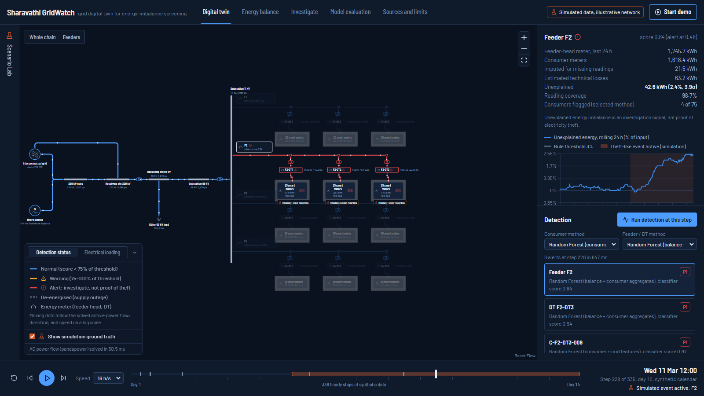

# Sharavathi GridWatch

**An interactive grid digital twin for energy-imbalance monitoring and AI-assisted
electricity-theft risk screening.** Fifth-semester CSE Experiential Learning project, SDG 9
(industry, innovation and infrastructure), with links to SDG 7 (affordable and clean energy).

> **All measurements are synthetic and the network is illustrative.** Only the names
> "Sharavathi" (KPCL's 1035 MW hydro station) and "SRS Peenya" (a KPTCL 220/66/11 kV receiving
> station) are anchored to public sources. No dedicated line between them is claimed. Alerts are
> investigation signals, **not proof of electricity theft**. See
> [`docs/research/source-note.md`](docs/research/source-note.md) and
> [`docs/limitations.md`](docs/limitations.md).



## What it does

1. **Simulates** an interconnected network (meshed 220 kV → receiving station → 66/11 kV
   substation → four 11 kV feeders → 12 distribution transformers → 300 smart-metered consumers)
   for 6 weeks at hourly resolution. Physics comes from a vectorised radial power flow, validated
   against pandapower, plus a pandapower AC snapshot of the whole network for the displayed hour.
2. **Injects scenarios** A–G (normal operation, sudden recorded-consumption deviation, unmetered
   load, persistent anomaly, missing or delayed readings, noise stress, technical-loss estimation
   error), deterministically from a seed.
3. **Accounts for energy** at feeder and DT boundaries:
   `U = E_in − E_metered − E_imputed − L_est`, with a calibrated loss estimate, imputation of
   missing data, and propagated uncertainty (z = U/σ).
4. **Detects** with transparent rules, Isolation Forest and Random Forest, each with
   consumer-only, boundary-only and combined signals.
5. **Explains** every alert from its own evidence (exact Random Forest contributions,
   evidence-based narratives) and **prioritises** it (field inspection P1/P2, desk review P3,
   meter-data review DQ).
6. **Shows** everything in a live digital twin: playback timeline, Scenario Lab, energy-balance
   explorer, linked investigation charts, method comparison, model evaluation and a
   three-minute guided demo.

## Research question and key results

*Can combining consumer-level anomaly detection with feeder/DT energy-balance analysis improve
the detection and prioritisation of simulated theft scenarios compared with threshold-based
detection alone?*

Test set: 30 held-out simulated runs (125,829 consumer-day windows, 1,875 positive). 95% cluster-bootstrap CIs.

| Consumer level | F1 [95% CI] | PR-AUC [95% CI] | Share of genuine consumption drops flagged |
|---|---|---|---|
| Consumer threshold rule | 0.462 [0.408, 0.516] | 0.363 [0.303, 0.421] | 0.68 |
| Combined rule (consumer AND DT balance) | 0.431 [0.358, 0.490] | 0.443 [0.380, 0.497] | 0.15 |
| Isolation Forest, consumer features | 0.521 [0.479, 0.562] | 0.374 [0.313, 0.439] | 0.85 |
| Random Forest, consumer features | 0.552 [0.512, 0.585] | 0.614 [0.568, 0.654] | 0.55 |
| **Random Forest, consumer + grid features** | 0.679 [0.633, 0.717] | 0.686 [0.639, 0.729] | 0.22 |

* **Adding grid (energy-balance) features to the consumer Random Forest helps**: paired ΔF1 = +0.127 [0.079, 0.169], ΔPR-AUC = +0.072 [0.030, 0.110]; versus the threshold rule ΔF1 = +0.217. The main mechanism: genuine consumption drops are flagged far less often (0.22 vs 0.55).
* **Not everything improves**: the combined *rule* trades recall for precision (F1 change -0.031, CI includes 0), and Isolation Forest gets worse with grid features (ΔF1 -0.152).
* **Feeder level**: boundary Random Forest F1 0.867 [0.834, 0.895] vs the default energy-balance rule 0.516 (precision 0.99, recall 0.35). With its threshold tuned on validation the rule reaches 0.838, so most of that gap is the conservative default 3% threshold. DT level: 0.785 vs 0.477.
* **Energy-balance validation**: the feeder balance recovers 0.9986 ± 0.0026 of injected unmetered energy plus the extra losses it causes.
* **Main weakness**: without loss calibration, a persistent 20–40% under-estimate of technical losses makes the boundary model flag almost every feeder; with calibration it is unaffected. More missing data or higher meter noise than assumed also raises boundary false alarms.

Full tables, confidence intervals, sweeps, localisation, detection delay and runtime:
[`docs/experiments/results.md`](docs/experiments/results.md). Interpretation:
[`docs/experiments/discussion.md`](docs/experiments/discussion.md). **These are results on the
project's synthetic benchmark only.**

## Quick start (Windows)

Requirements: **Python 3.12** (the `py` launcher) and **Node.js 20+**. Docker is optional.

```powershell
.\scripts\setup.ps1     # creates backend\.venv, installs pinned packages, builds the UI
.\scripts\run.ps1       # serves API and UI at http://127.0.0.1:8000
```

Open http://127.0.0.1:8000 and click **Start demo**. On first start without saved models the
API trains them (about 30–60 s, logged); the trained models are identical to the evaluated ones
because all seeds are fixed. Keep the project in a reasonably short folder path: Windows limits
paths to 260 characters by default, and one npm package runs an install script deep inside
`node_modules`. Linux/macOS: `scripts/setup.sh`, then `scripts/run.sh` (not tested; see
[`docs/acceptance-tests.md`](docs/acceptance-tests.md)).

### Development mode

```powershell
cd backend;  .\.venv\Scripts\python.exe -m uvicorn gridwatch.api.main:app --reload --port 8000
cd frontend; npm run dev        # http://localhost:5173, proxies /api to :8000
```

### Reproduce the experiments

```powershell
cd backend
.\.venv\Scripts\python.exe -m gridwatch.experiments.run          # ~25 min, 8 worker processes
.\.venv\Scripts\python.exe -m gridwatch.experiments.run --quick  # ~4 min smoke version
```

This trains the models used by the app (`backend/artifacts/models/`), writes
`backend/artifacts/results/results.json`, per-window test predictions
(`test_predictions_*.csv.gz`) and regenerates `docs/experiments/results.md`.

### Tests

```powershell
cd backend;  .\.venv\Scripts\python.exe -m pytest             # 43 backend tests, ~15 s
cd frontend; npm run typecheck
cd frontend; npx playwright install chromium; npm run e2e     # 12 UI acceptance tests (app must be running)
```

### Docker

`Dockerfile` and `docker-compose.yml` are provided (`docker compose up --build`), but **they
were not built or run during development** because Docker was not installed. Treat them as
untested.

## Repository layout

```
backend/
  gridwatch/
    simulation/      topology, load profiles, scenarios, generator, radial power flow, pandapower snapshot
    energy_balance/  loss estimate, calibration, energy balance with uncertainty
    features/        expected-profile baseline, causal features, rules, labels
    detection/       method catalogue, training, thresholds, scoring, persistence
    explanations/    narratives, RF contributions, IF deviations, inspection priority
    experiments/     benchmark generator, metrics, experiment suite, report writer
    api/             FastAPI application
    engine.py        a live simulation run (state, alerts, comparison, time series)
    pipeline.py      config -> data -> features path shared by API, training and experiments
  tests/             pytest suite
  artifacts/         results.json (committed), models and predictions (generated)
frontend/
  src/               React + TypeScript app (React Flow canvas, Recharts charts, Tailwind)
  e2e/               Playwright UI acceptance tests
  scripts/           screenshot and demo walk-through helpers
docs/                research, methodology, architecture, experiments, demo script, slides outline
scripts/             setup and run scripts
```

## Documentation

| Topic | File |
|---|---|
| Real-world context, sources, novelty | [docs/research/source-note.md](docs/research/source-note.md) |
| Architecture and API | [docs/architecture/architecture.md](docs/architecture/architecture.md) |
| Dataset generation | [docs/methodology/dataset-generation.md](docs/methodology/dataset-generation.md) |
| Energy-balance method | [docs/methodology/energy-balance.md](docs/methodology/energy-balance.md) |
| Models, explanations, priority | [docs/methodology/models.md](docs/methodology/models.md) |
| Data dictionary | [docs/methodology/data-dictionary.md](docs/methodology/data-dictionary.md) |
| Experimental results (generated) | [docs/experiments/results.md](docs/experiments/results.md) |
| Discussion of results | [docs/experiments/discussion.md](docs/experiments/discussion.md) |
| Acceptance-test record | [docs/acceptance-tests.md](docs/acceptance-tests.md) |
| Limitations and ethics | [docs/limitations.md](docs/limitations.md) |
| Faculty demo script | [docs/demo-script.md](docs/demo-script.md) |
| Presentation outline | [docs/presentation-outline.md](docs/presentation-outline.md) |

Interactive API documentation is served at http://127.0.0.1:8000/docs.

## Responsible use

The software works on synthetic data only, connects to no real grid or utility system, uses
synthetic identifiers, and describes no method of tampering with meters. Unexplained energy can
come from technical losses, meter error, missing or delayed data, timing mismatches and outages.
Real investigations require authorised field inspection and due process.
