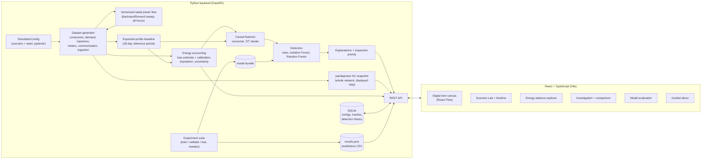

# Architecture

## Layers and modules (`backend/gridwatch`)

| Module | Responsibility |
|---|---|
| `simulation/topology.py` | Illustrative network definition with a provenance label per element |
| `simulation/profiles.py` | Load-shape templates, power factors, illustrative dispatch |
| `simulation/scenarios.py` | Validated scenario configuration (A–G, composite), demo preset |
| `simulation/generator.py` | Synthetic data, injections, meters, communication, ingestion, hashing |
| `simulation/feeder_flow.py` | Vectorised backward/forward-sweep radial power flow |
| `simulation/grid_snapshot.py` | pandapower model of the whole network for a displayed step |
| `features/baseline.py` | Expected consumption profiles from the reference period |
| `energy_balance/` | Loss estimate, calibration, energy balance with uncertainty and data quality |
| `features/build.py` | Causal feature engineering, rules, labels |
| `detection/` | Method catalogue, training, threshold selection, scoring, persistence |
| `explanations/explain.py` | Narrative explanations, RF contributions, IF deviations, priority |
| `engine.py` | A live simulation run: caching, timeline precomputation, state, alerts, comparisons |
| `pipeline.py` | Shared config → data → features path used by API, training and experiments |
| `storage.py` | SQLite persistence |
| `experiments/` | Benchmark generator, metrics, experiment suite, report writer |
| `api/main.py` | FastAPI app; also serves the built frontend |

## How one timeline step is served

1. The UI requests `GET /state?t=…`. Playback advances only after the response for the
   current step has arrived, so the visuals never run ahead of the simulation.
2. The engine reads the features for step *t* (LRU cache) and the detector scores (from the
   background-precomputed timeline, otherwise computed now through the same functions).
3. pandapower solves the whole network for the hourly-average true demand at *t* (cached).
4. The response carries power-flow results, 24 h balances, scores, statuses and event phases.
   The canvas colours and particle animation are derived from these numbers alone.

Moving backward in time recomputes or reloads the exact state; data are regenerated from
(config, seed) whenever a run is evicted from memory and checked against the stored hash.

## REST API

OpenAPI documentation is served at `http://127.0.0.1:8000/docs`.

| Method and path | Purpose |
|---|---|
| `GET /api/health` | Liveness, models loaded |
| `GET /api/meta` | Scenario catalogue, config schema, methods, thresholds, rules, demo preset |
| `GET /api/provenance` | Verified facts with sources, unverified items, assumptions, ethics |
| `GET /api/models` | Training metadata and thresholds |
| `POST /api/simulations` | Create a run from `{config, rules?}` |
| `POST /api/simulations/demo` | Create the faculty demo run |
| `GET /api/simulations` | Experiment history |
| `GET /api/simulations/{id}` | Run summary (events, outages, ingestion, hash) |
| `GET /api/simulations/{id}/topology` | Network elements with parameters and provenance |
| `GET /api/simulations/{id}/state?t=` | Network state at a step |
| `GET /api/simulations/{id}/alerts?t=` | Alerts with explanations (not recorded) |
| `POST /api/simulations/{id}/detect` | Execute detectors at a step, record a detection run |
| `GET /api/simulations/{id}/compare?t=` | All methods versus ground truth, disagreements |
| `GET /api/simulations/{id}/energy-balance?kind=&id=&t=&start=&end=` | Balance for a boundary and window |
| `GET /api/simulations/{id}/feeders/{fid}/timeseries?t=` | Hourly terms, rolling balance, score history |
| `GET /api/simulations/{id}/dts/{dt}/timeseries?t=` | Same for a DT |
| `GET /api/simulations/{id}/consumers?t=&feeder=&dt=&method=` | Ranked consumers |
| `GET /api/simulations/{id}/consumers/{cid}/timeseries` | Readings, arrival, expected, scores |
| `GET /api/simulations/{id}/baseline-diff?t=` | Measurements that differ from normal operation (same seed) |
| `POST /api/simulations/{id}/replay?t=` | Regenerate from seed; compare hash and scores |
| `GET /api/detections` | Recorded detection runs |
| `GET /api/experiments/results` | Saved experiment results |

Validation errors return 422 with a message, and unknown runs return 404.

## Design decisions

* **Vite SPA instead of Next.js.** No server rendering or routing is needed. FastAPI serves the
  built bundle, so the demo runs as one process.
* **React Flow** is the single canvas technology (zoom, pan, selection, custom SVG nodes and
  edges). **Recharts** is used for charts.
* **Two power-flow solvers** for two jobs: the vectorised sweep gives weeks of hourly feeder
  energy and losses in milliseconds for accounting, and pandapower solves the meshed whole
  network for the displayed step. The sweep is validated against pandapower in tests.
* **SQLite** stores configurations, hashes and detection history; datasets are regenerated from
  seeds rather than stored.
* **No live connections**: the software never talks to real grid equipment or utility systems.
